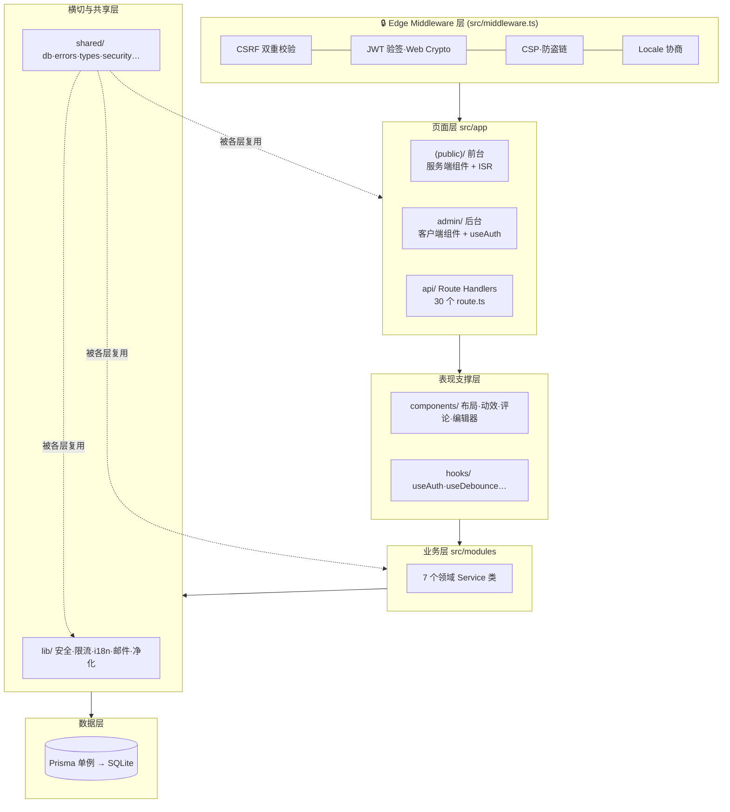
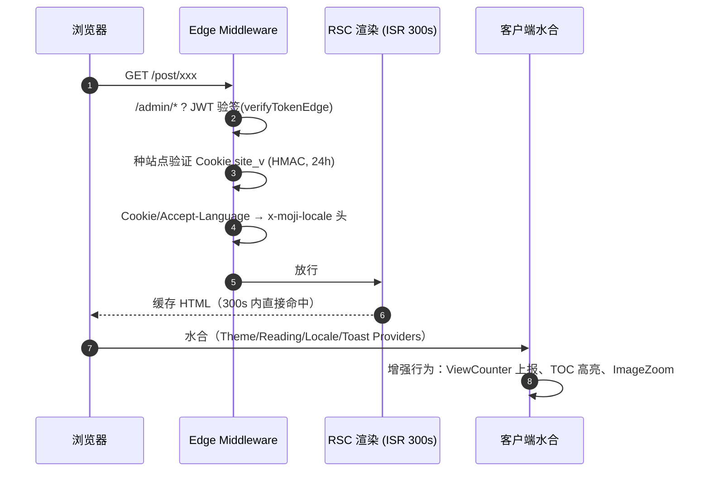
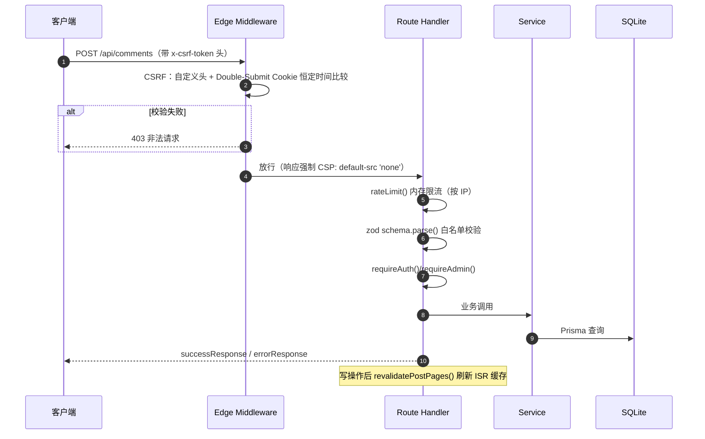
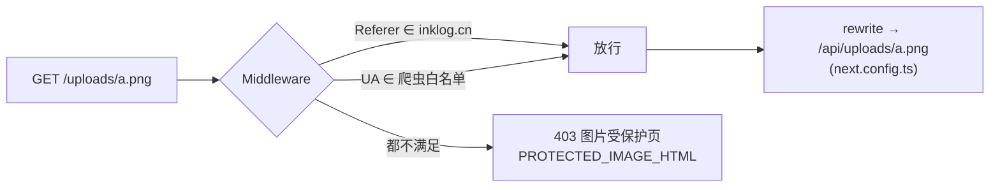
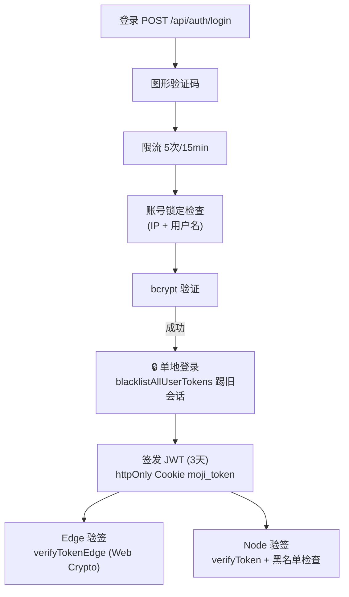
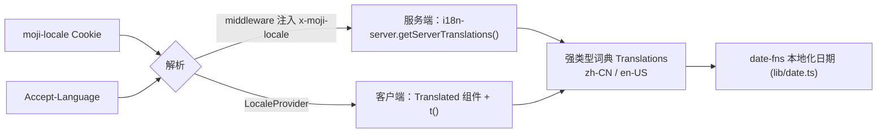

# 01 · 架构总览

> 🏠 [Wiki 首页](README.md) ｜ **当前：01 架构总览** ｜ 下一章 → [02-数据模型](02-data-model.md)

**本文包含**：[1. 技术分层](#1-技术分层) · [2. 目录结构](#2-目录结构) · [3. 请求流转](#3-请求流转) · [4. 渲染与缓存](#4-渲染与缓存策略) · [5. 安全架构](#5-安全架构) · [6. 国际化](#6-国际化i18n) · [7. 清理任务](#7-后台清理任务)

---

## 1. 技术分层



> 💡 分层铁律：**页面/路由 → Service → shared**，禁止页面直接操作 Prisma；唯一例外是 `api/stats` 等只读聚合直接使用 prisma 单例。

## 2. 目录结构

```
moji-blog/
├── prisma/
│   ├── schema.prisma          # 数据模型（13 个模型）→ 详见 02-数据模型
│   └── seed.ts                # 初始化管理员/分类/标签/示例文章
├── public/                    # 静态资源（favicon、manifest、OG 图）
├── src/
│   ├── middleware.ts          # 🔒 Edge 中间件（安全 + locale）
│   ├── app/
│   │   ├── (public)/          # 前台路由组（首页/归档/文章/分类/标签/搜索）
│   │   ├── admin/             # 后台（login/dashboard/posts/editor/…）
│   │   ├── api/               # API 路由 → 详见 04-API 参考
│   │   ├── layout.tsx         # 根布局 + 全局 Provider 链
│   │   └── page.tsx not-found.tsx robots.ts sitemap.ts
│   ├── components/            # → 详见 05-组件与 Hooks
│   ├── hooks/                 # 4 个自定义 Hook
│   ├── lib/                   # 横切工具 → 详见 06-工具库
│   ├── modules/               # 业务服务 → 详见 03-业务模块
│   ├── shared/                # 共享基础 → 详见 06-工具库
│   └── styles/globals.css     # Tailwind 4 + 水墨主题
├── next.config.ts             # rewrites: /uploads/* → /api/uploads/*
├── ecosystem.config.js        # PM2 配置（max_memory_restart 300M）
└── .env.example               # 环境变量模板 → 详见 08-运行与部署
```

## 3. 请求流转

### 3.1 页面请求（前台）



### 3.2 API 请求



### 3.3 上传文件访问



> 💡 防盗链不依赖 Cookie，避免首次加载时 Cookie 时序问题导致图片裂图。

## 4. 渲染与缓存策略

| 页面 | 方式 | 缓存 |
|---|---|---|
| 首页 `/` | 服务端组件 | `revalidate = 300`（ISR） |
| 文章详情 `/post/[slug]` | 服务端组件 | `revalidate = 300` + `generateStaticParams` 预生成 |
| 归档/分类/标签 | 服务端组件 | ISR；搜索页动态 |
| robots.ts / sitemap.ts | Metadata Routes | sitemap 动态含已发布文章 |
| `/admin/*` | 客户端组件 | 不缓存 |

🔄 **缓存失效链路**：文章/分类/标签写操作 → [revalidatePostPages()](06-lib-shared.md#revalidatets) 刷新首页、归档页、新旧 slug 文章页及分类、标签页缓存。

## 5. 安全架构

### 5.1 认证与会话



- **角色**：`admin / author / reader`；注册接口已关闭（403），账号由管理员后台创建 🔒
- **Token 黑名单**：登出拉黑 + 单地登录，存 `TokenBlacklist` 表（仅存 sha256 哈希）
- **密码**：bcrypt 12 轮

### 5.2 请求防护矩阵

| 机制 | 实现 | 位置 |
|---|---|---|
| 🔒 CSRF | 自定义头 + Double-Submit Cookie 恒定时间比较；仅非幂等方法 | [middleware.ts](file:///workspace/src/middleware.ts) `checkCsrf()` |
| 限流 | 内存 Map 固定窗口：login 5/15min · register 3/h · comment 5/min · general 30/min | [lib/ratelimit.ts](file:///workspace/src/lib/ratelimit.ts) |
| 账号锁定 | IP 级 5 次/15min + 用户名连续 5 次锁 30min | lib/account-lockout.ts |
| 图形验证码 | SVG 干扰线 + 一次性消费 | lib/captcha.ts |
| 邮箱验证码 | 6 位码 + 过期表；管理员敏感操作独立内存码 | lib/mailer.ts · lib/admin-email-codes.ts |
| 内容过滤 | 敏感词 / URL / 手机号 / 社交账号正则 | lib/content-filter.ts |
| 🔒 XSS | DOMPurify 白名单（正文/评论）+ SVG 专用净化 | lib/sanitize.ts · lib/sanitize-svg.ts |
| IP 隐私 | 评论仅存 `sha256(ip+salt)` 前 16 位 | shared/security.ts `hashIP()` |
| 🔒 防盗链 | Referer 白名单 + 爬虫 UA 白名单 | middleware.ts + shared/site-secret.ts |
| 🔒 CSP | API：`default-src 'none'`；页面因 ISR 不加 CSP，靠 sanitize 兜底 | middleware.ts |
| 🔒 SSRF | `images.remotePatterns: []` 禁远程图片优化 | next.config.ts |

### 5.3 上传安全（/api/upload）

类型白名单 → **魔数校验** → SVG 净化 → sharp 压缩 → 仅允许本站 `/uploads/` 路径入库（`postImageUrlSchema` 强约束）。

## 6. 国际化（i18n）



## 7. 后台清理任务

[cleanup-registry.ts](file:///workspace/src/shared/cleanup-registry.ts) 提供命名定时任务注册表 `registerCleanup(name, fn, intervalMs)`：

| 任务 | 周期 | 目的 |
|---|---|---|
| ratelimit-cleanup | 60s | 清理过期限流条目 |
| view-dedup-cleanup | 60s | 清理浏览量去重窗口 |
| token 黑名单清理 | 定期 | 清理过期 token |

> 💡 设计目的：限流/去重均基于内存 Map，不注册清理会造成长期运行内存泄漏。

---

*⬅️ [Wiki 首页](README.md) ｜ ➡️ 下一章 [02-数据模型](02-data-model.md)*
