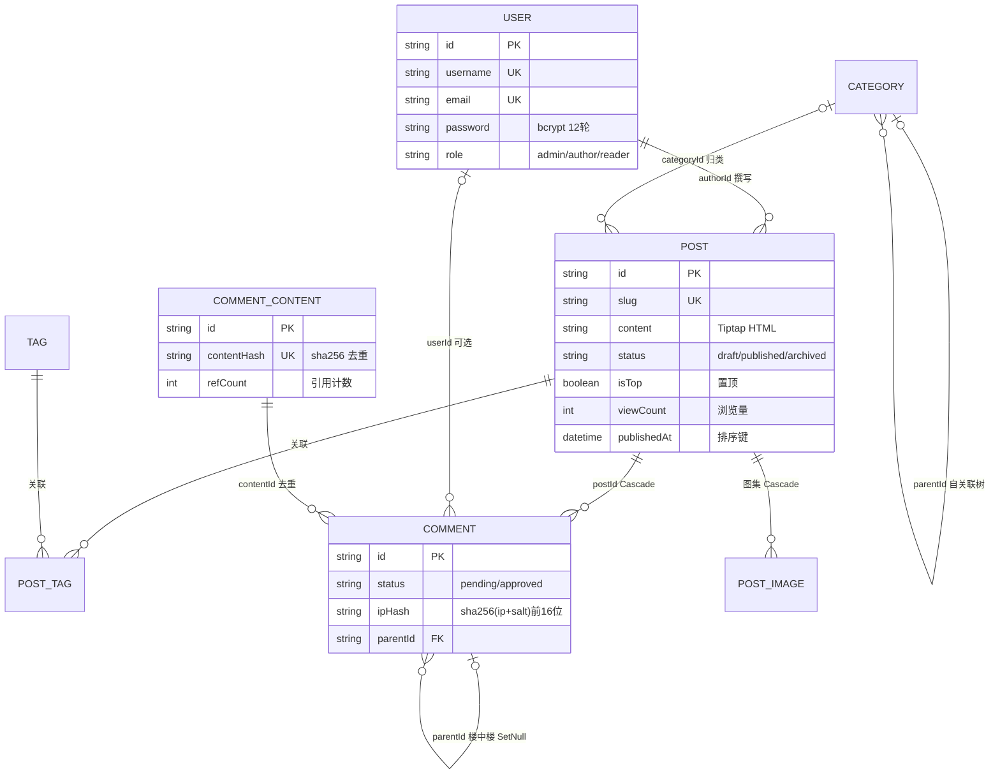
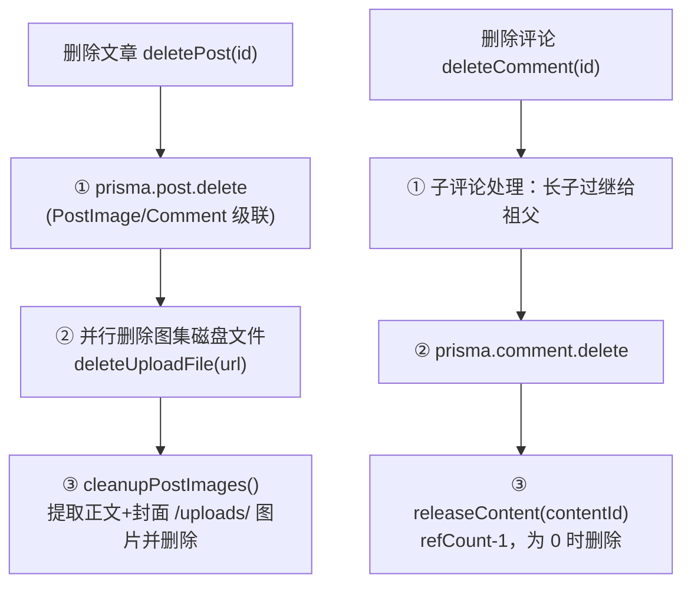

# 02 · 数据模型（Prisma）

> 🏠 [Wiki 首页](README.md) ｜ ⬅️ [01-架构总览](01-architecture.md) ｜ **当前：02 数据模型** ｜ 下一章 → [03-业务模块](03-modules.md)

**本文包含**：[1. ER 关系图](#1-er-关系图) · [2. 模型明细](#2-模型明细) · [3. 级联与清理策略](#3-级联与清理策略) · [4. 种子数据](#4-种子数据prismaseedts)

> 源文件：[prisma/schema.prisma](file:///workspace/prisma/schema.prisma) ｜ 数据库 SQLite，全部模型经 `@@map` 映射到蛇形命名表

---

## 1. ER 关系图

**辅助表**（无外键关联）：`SiteConfig`（KV 配置）· `TokenBlacklist`（JWT 黑名单）· `Captcha`（图形验证码）· `EmailVerification`（邮箱验证码）

## 2. 模型明细

### User（users）

| 字段 | 类型 | 说明 |
|---|---|---|
| id | String cuid @id | |
| username | String @unique | 登录名（登录也支持邮箱） |
| email | String @unique | |
| password | String | bcrypt 12 轮哈希 |
| displayName / avatar | String? | 作者公开字段仅暴露 `{displayName, avatar, role}` |
| role | String default "author" | admin / author / reader |

关联：`posts[]`、`comments[]`

### Post（posts）★ 核心模型

| 字段 | 类型 | 说明 |
|---|---|---|
| slug | String @unique | URL 标识，`/post/[slug]` |
| title / content / summary | String | 正文为 Tiptap 输出的 HTML |
| coverImage | String? | 封面，仅允许 `/uploads/` 本站路径 |
| status | String default "draft" | draft / published / archived |
| isTop / isEssence / isOutdated | Boolean | 置顶 / 精华 / 过时标记 |
| aiSummary | String? | AI 摘要 |
| viewCount | Int default 0 | 异步递增（`/api/view`） |
| publishedAt | DateTime? | 首次发布时间，列表排序键 |
| authorId / categoryId | FK | → User / Category? |

**索引**：`status` · `publishedAt` · `authorId` · 复合 `(status, publishedAt)` ← 已发布列表查询专用

### Category（categories）— 自关联树

- `parentId → parent` / `children[]`（关系名 `CategoryTree`）
- `name` / `slug` 双唯一，`sortOrder` 排序
- ⚠️ 删除有子分类的分类会被业务层拒绝（[CategoryService](03-modules.md#5-categoryservice--tagservice)）

### Tag（tags）+ PostTag（post_tags）

- Tag：`name` / `slug` 双唯一
- PostTag：复合主键 `(postId, tagId)`，双向 `onDelete: Cascade`（删文章/标签自动清理关联）

### Comment（comments）— 自关联树 + 内容外置

| 字段 | 说明 |
|---|---|
| status | default "pending"：pending / approved（管理员评论自动通过） |
| authorName / authorEmail | 仅匿名评论者；登录用户不存（避免重复） |
| ipHash | `sha256(ip + IP_HASH_SALT)` 前 16 位 🔒 隐私保护 |
| contentId | → CommentContent，正文外置去重 |
| postId | → Post（Cascade） |
| userId | → User? 登录评论者 |
| parentId | → Comment?（**SetNull**）楼中楼 |

**索引**：`postId` · `status` · `contentId` · `parentId` · 复合 `(postId, status)` · `createdAt`

### CommentContent（comment_contents）— 💡 内容去重设计

| 字段 | 说明 |
|---|---|
| content | 原文（首见内容） |
| contentHash | sha256，**唯一** |
| refCount | 引用计数，默认 1 |

去重流程：`trim + lowercase` 归一化 → sha256 → 命中则 `refCount+1`，否则新建。删除评论时 `refCount-1`，**减到 0 才物理删除**。

### PostImage（post_images）

文章图集：`url` · `sortOrder`（可重排序）· `postId`（Cascade）。⚠️ 级联只删记录，磁盘文件由 [PostService.deletePost](03-modules.md#3-postservice) 应用层清理。

### SiteConfig / TokenBlacklist / Captcha / EmailVerification

| 模型 | 结构 | 用途 |
|---|---|---|
| SiteConfig | `key @id` / `value` | 站点配置 KV，[ConfigService](03-modules.md#7-configservice) upsert 读写 |
| TokenBlacklist | `tokenHash @id`(sha256) / `userId?` / `exp` | 登出失效 + 单地登录；索引 `exp`、`userId`，定期清理过期项 |
| Captcha | `token @id` / `answer` / `expires` | 图形验证码，一次性消费 |
| EmailVerification | `email` / `code`(6位) / `expires` | 邮箱验证码；索引 `email`、`expires` |

## 3. 级联与清理策略

| 操作 | 数据库行为 | 应用层补充 |
|---|---|---|
| 删除 Post | Comment / PostImage / PostTag 级联删除 | `PostService.deletePost`：**先删记录再清文件**（防回滚孤儿）→ 删 PostImage 磁盘文件 → `cleanupPostImages()` 清理正文/封面内嵌图 |
| 删除 Comment | parentId SetNull | `deleteComment`：长子"过继"给祖父、其余挂到长子 → 删除 → `releaseContent()` 释放引用计数 |
| 删除 Tag | PostTag 级联删除 | — |

## 4. 种子数据（prisma/seed.ts）

| 数据 | 内容 |
|---|---|
| 管理员 | 用户名 `饕餮_adminheibao`（admin 角色） |
| 分类 | 技术、生活、随笔 |
| 标签 | JavaScript、TypeScript、React、Next.js |
| 文章 | 若干示例文章（关联作者/分类/标签/发布时间） |

> ⚠️ **安全提醒**：seed 中含默认密码明文，生产部署后应立即修改。

---

*⬅️ [上一章 01-架构总览](01-architecture.md) ｜ 🏠 [Wiki 首页](README.md) ｜ ➡️ 下一章 [03-业务模块](03-modules.md)*
