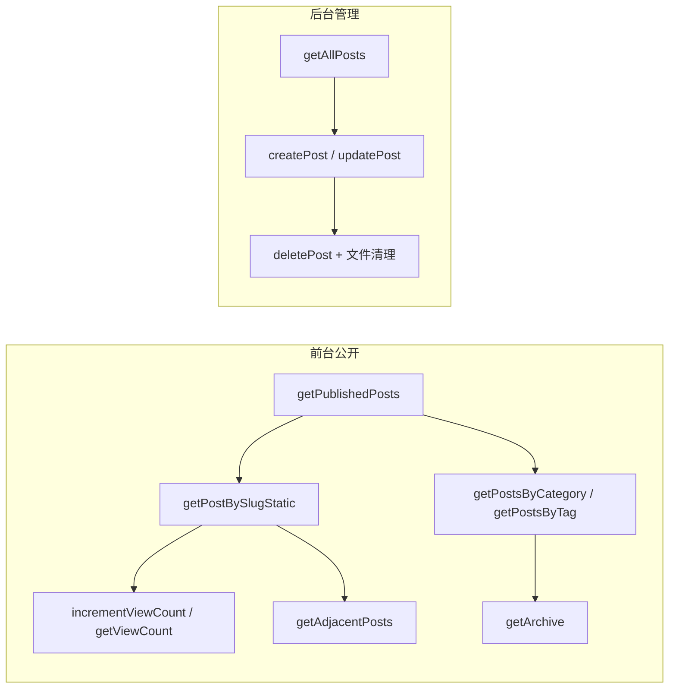
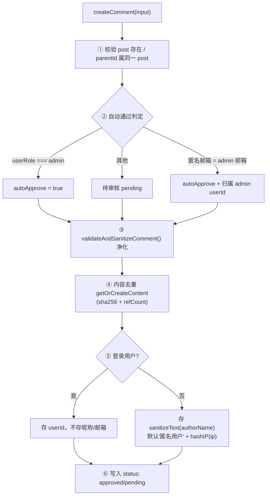
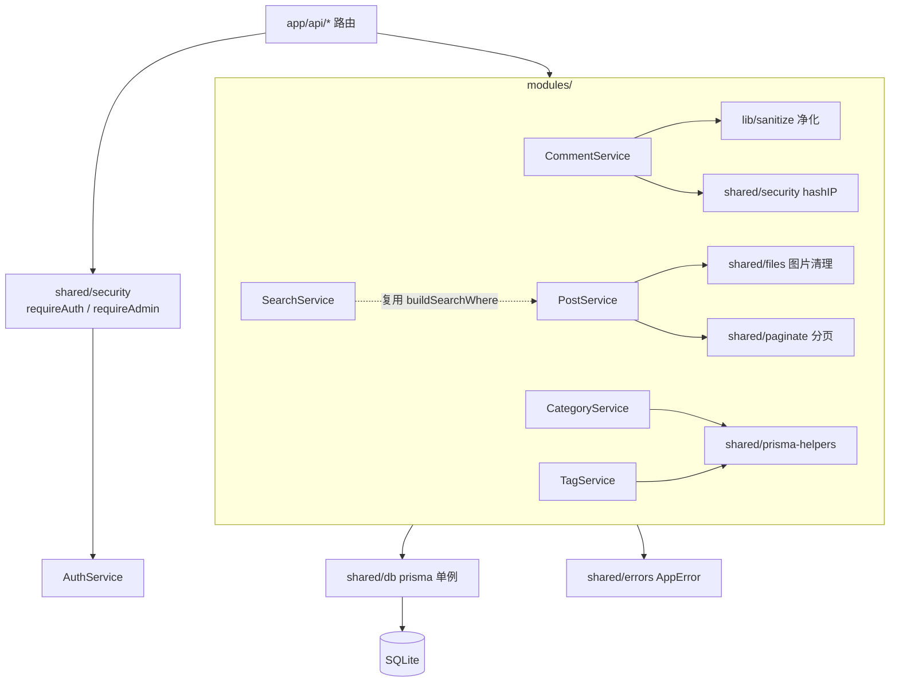

# 03 · 业务模块（src/modules）

> 🏠 [Wiki 首页](README.md) ｜ ⬅️ [02-数据模型](02-data-model.md) ｜ **当前：03 业务模块** ｜ 下一章 → [04-API 参考](04-api-reference.md)

**本文包含**：[1. 模块清单](#1-模块清单) · [2. AuthService](#2-authservice) · [3. PostService](#3-postservice) · [4. CommentService](#4-commentservice) · [5. Category/Tag](#5-categoryservice--tagservice) · [6. SearchService](#6-searchservice) · [7. ConfigService](#7-configservice) · [8. 模块间依赖](#8-模块间依赖)

> 架构约定：Service Class + 模块级单例导出（如 `postService`），统一经 `@/shared/db` Prisma 单例访问数据库，错误统一抛 `AppError`。

---

## 1. 模块清单

| 模块 | 文件 | 职责 | 主要数据模型 |
|---|---|---|---|
| auth | [auth/service.ts](file:///workspace/src/modules/auth/service.ts) | 登录/注册/资料 | User |
| post | [post/service.ts](file:///workspace/src/modules/post/service.ts) | 文章全生命周期 | Post, PostImage, PostTag |
| comment | [comment/service.ts](file:///workspace/src/modules/comment/service.ts) | 评论树/审核/去重 | Comment, CommentContent |
| category | [category/service.ts](file:///workspace/src/modules/category/service.ts) | 分类树 CRUD | Category |
| tag | [tag/service.ts](file:///workspace/src/modules/tag/service.ts) | 标签 CRUD | Tag |
| search | [search/service.ts](file:///workspace/src/modules/search/service.ts) | 公开搜索 | Post |
| config | [config/service.ts](file:///workspace/src/modules/config/service.ts) | 站点配置 KV | SiteConfig |

## 2. AuthService

```ts
class AuthService {
  async login(input: LoginInput): Promise<{ token, user }>       // 用户名或邮箱登录
  async register(input: RegisterInput): Promise<{ token, user }> // 注册（当前路由层已关闭）
  async getProfile(userId: string)                               // 资料含 _count.posts
  async updateProfile(userId, data: { displayName?, avatar?, email? })
}
export const authService = new AuthService();
```

| 方法 | 关键行为 |
|---|---|
| `login` | `input.username` 含 `@` 按 email 查、否则按 username 查；bcrypt 校验；成功后 `blacklistAllUserTokens(user.id)` 🔒 **单地登录**踢掉所有旧会话，再签发新 JWT |
| `register` | 用户名/邮箱查重（409）；bcrypt 12 轮；默认 `author` 角色（⚠️ 路由层已关闭注册） |
| `getProfile` | select 白名单字段 + `_count.posts`；404 兜底 |
| `updateProfile` | 字段级增量更新；email 更新前查重（409）；空更新抛 400 |

## 3. PostService

**模块级共享导出**：

| 导出 | 用途 |
|---|---|
| `AUTHOR_PUBLIC_SELECT` | 前台作者公开字段 `{displayName, avatar, role}` |
| `AUTHOR_ADMIN_SELECT` | 后台作者字段 `{id, username}` |
| `buildSearchWhere(search, fields?)` | 构造 `OR: [{field: {contains}}]`，与 SearchService 共用 |

### 方法一览

| 方法 | 签名要点 | 说明 |
|---|---|---|
| `getPublishedPosts` | `(PaginationInput)` → `{posts, page, pageSize, hasMore}` | 前台列表；`status=published`；排序 `[isTop desc, publishedAt desc]`；含作者/分类/标签/评论数；取 `pageSize+1` 判断 hasMore |
| `getPostBySlugStatic` | `(slug)` → Post | 静态渲染用，**不递增浏览量**；含 images（按 sortOrder） |
| `incrementViewCount` | `(slug)` → `{viewCount}` | `update viewCount: {increment:1}`；Prisma P2025 转 404 |
| `getViewCount` | `(slug)` → `{viewCount}` | 只读，ViewCounter 组件轮询 |
| `getAllPosts` | `(PaginationInput & {status?})` → `{posts, total, totalPages}` | 后台列表；搜索仅 title/summary；`Promise.all` 并行取数与计数 |
| `getPostById` | `(id)` | 后台编辑用，含 tags/images |
| `createPost` | `(CreatePostInput, authorId)` | slug 查重（409）；`status=published` 时写 `publishedAt`；tagIds 建关联 |
| `updatePost` | `(id, UpdatePostInput)` | 🔒 **显式白名单**逐字段拷贝防意外写入；slug 变更查重；非 published→published 补 `publishedAt`；tagIds `deleteMany + create` 全量替换 |
| `deletePost` | `(id)` | 先删 DB（级联）→ 再删图片磁盘文件 → `cleanupPostImages()` 清正文/封面内嵌图 |
| `getPostsByCategory` | `(categorySlug, PaginationInput)` | 分类 404 兜底；返回 `{category, posts, hasMore}` |
| `getPostsByTag` | `(tagSlug, PaginationInput)` | `tags: {some: {tagId}}` 过滤；返回 `{tag, posts, hasMore}` |
| `getArchive` | `()` → `Record<"YYYY-MM", Post[]>` | 按月分组；`take: 1000` 上限保护防内存溢出 |
| `getAdjacentPosts` | `(publishedAt, currentId)` | 上一篇（`lt` 取最近）/ 下一篇（`gt` 取最早） |



## 4. CommentService

**模块私有工具**：

| 函数 | 说明 |
|---|---|
| `normalizeContent` / `contentHash` | trim+lowercase → sha256 |
| `getOrCreateContent(raw)` | 哈希命中 `refCount+1`，否则新建 |
| `releaseContent(contentId)` | `refCount-1`，减到 0 物理删除 |
| `formatComment(c)` | 🔒 剥离 `authorEmail/ipHash` 敏感字段，注入 content 文本与空 replies |
| `buildCommentTree(all)` | 💡 **O(n) 两遍扫描**（Map 索引）构建楼中楼树，避免嵌套循环 |

### 方法一览

| 方法 | 说明 |
|---|---|
| `getPostComments(postId)` | 前台：仅 `approved`，时间升序，O(n) 建树 |
| `createComment(input, userId?, ip?, userRole?)` | 见下方流程图 |
| `getAllComments({page,pageSize,status?,search?,postId?})` | 后台：搜索覆盖评论内容/昵称/用户名；关联 post、user |
| `getPostOptions()` | 最近 100 篇 `{id,title}`，后台筛选下拉 |
| `updateCommentStatus(id, status)` | 单条审核 |
| `batchUpdateStatus(ids, status)` | `updateMany`，上限 100 条 |
| `batchDelete(ids)` | 逐条删、失败跳过、返回成功数 |
| `deleteComment(id)` | 子评论过继 + 释放 CommentContent |

### 创建评论流程



## 5. CategoryService / TagService

| Service | 要点 |
|---|---|
| `CategoryService` | 分类 CRUD；父子分类 + `sortOrder`；P2002 唯一冲突经 `handlePrismaUniqueError` 转友好报错；**删除前检查子分类** |
| `TagService` | 标签 CRUD；slug 唯一性处理；删除前存在性校验 |

## 6. SearchService

复用 `PostService.buildSearchWhere`，仅查 `published`，按 `publishedAt desc`，返回摘要 + 分类信息 → 供 `/api/search`（Cmd+K 弹层与搜索页）。

## 7. ConfigService

站点配置 KV 读写：读取带**默认配置兜底**，写入用 `prisma.siteConfig.upsert`（按 key 创建或更新）。

## 8. 模块间依赖



---

*⬅️ [上一章 02-数据模型](02-data-model.md) ｜ 🏠 [Wiki 首页](README.md) ｜ ➡️ 下一章 [04-API 参考](04-api-reference.md)*
