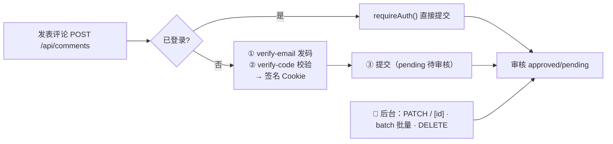
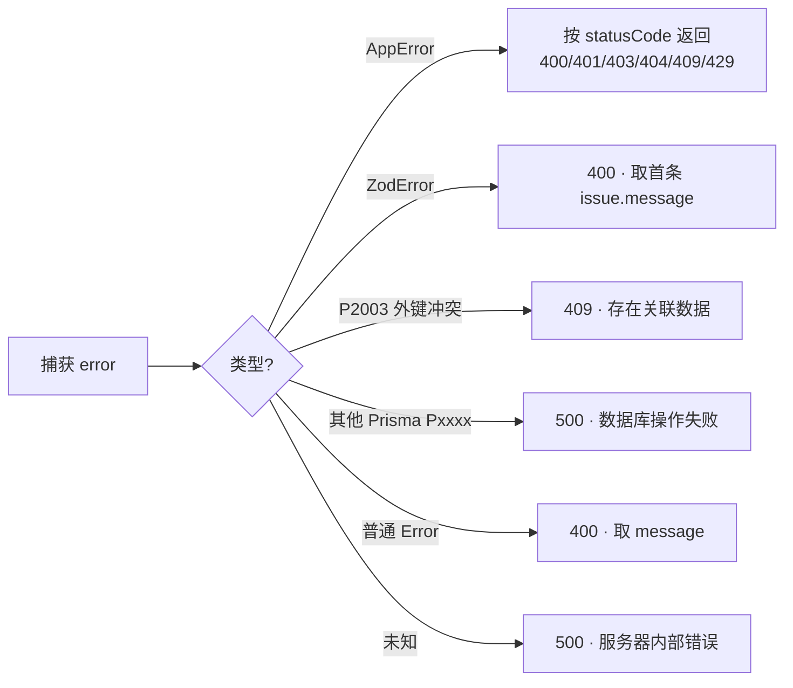

# 04 · API 参考（src/app/api）

> 🏠 [Wiki 首页](README.md) ｜ ⬅️ [03-业务模块](03-modules.md) ｜ **当前：04 API 参考** ｜ 下一章 → [05-组件与 Hooks](05-components.md)

**本文包含**：[全局约定](#1-全局约定) · [Auth](#2-authapiauth) · [Posts](#3-postsapiposts) · [Comments](#4-commentsapicomments) · [Categories/Tags](#5-categories--tags管理端均为-admin) · [Upload](#6-uploadapiupload) · [其他](#7-其他) · [错误约定](#8-错误响应约定sharederrorsts)

---

## 1. 全局约定

- **规模**：30 个 `route.ts`，44 个方法
- 🔒 **CSRF**：所有非幂等方法经 Middleware 双重校验（`x-requested-with: XMLHttpRequest` + `x-csrf-token` 匹配 `moji_csrf` Cookie）；唯一豁免 `/api/disclaimer/accept`
- **响应**：`successResponse(data)` → `{data}`；`errorResponse(error)` 统一映射
- 🔒 API 响应强制 `CSP: default-src 'none'`

**鉴权标记说明**（定义于 [shared/security.ts](file:///workspace/src/shared/security.ts)）：

| 标记 | 含义 |
|---|---|
| 🌐 公开 | 无需登录 |
| 🔑 登录 | `requireAuth()`，未登录 401 |
| 👑 admin | `requireAdmin()`，非 admin 403 |
| ◑ 可选 | 登录与否行为不同 |

## 2. Auth（/api/auth）

| 路由 | 方法 | 鉴权 | 功能 | 关键逻辑 |
|---|---|---|---|---|
| `/api/auth/captcha` | GET | 🌐 | 获取图形验证码 | `createCaptcha()` → `{token, svg(base64)}`，存 Captcha 表 |
| `/api/auth/login` | POST | 🌐 | 登录 | ① `rateLimit(login)` 5 次/15min/IP ② 图形验证码 ③ `loginSchema` ④ 账号锁定检查（IP 5 次/15min；用户名连败 5 次锁 30min）⑤ `authService.login()` 单地登录踢旧会话 ⑥ 写 `moji_token` + `moji_csrf` Cookie |
| `/api/auth/logout` | POST | 🌐 | 登出 | token 加入黑名单 → 清 auth/CSRF Cookie |
| `/api/auth/me` | GET | 🌐 | 当前用户 | `getCurrentUser()`，未登录返回 null |
| `/api/auth/me` | PATCH | 🔑 | 更新资料 | `updateProfileSchema`（strict 白名单）→ `authService.updateProfile()` |
| `/api/auth/register` | POST | — | 注册 | ⚠️ **已关闭**：固定 403（仅管理员后台建号） |
| `/api/auth/bind-email` | POST | 🔑 | 绑定邮箱 | 邮箱格式/域名白名单/唯一性 + `adminEmailCodes` 6 位码 → `updateProfile({email})` |
| `/api/auth/send-email-code` | POST | 🔑 | 发送邮箱验证码 | 限流 → 域名/唯一性校验 → 6 位码 → `sendVerificationEmail()` |
| `/api/auth/update-credentials` | POST | 🔑 | 改用户名/密码 | `updateCredentialsSchema` 判别联合（username/password）；管理员邮箱码或会话已验证；改用户名查重、改密码验旧 |

## 3. Posts（/api/posts）

| 路由 | 方法 | 鉴权 | 功能 |
|---|---|---|---|
| `/api/posts` | GET | 🌐 | 公开列表；`paginationSchema`（page≥1，pageSize≤100 默认 12）；`getPublishedPosts()` |
| `/api/posts` | POST | 👑 | 创建；`createPostSchema`；`published` 时 `revalidatePostPages(slug)` 刷 ISR |
| `/api/posts/[id]` | GET | 👑 | 编辑用详情（含 tags/images） |
| `/api/posts/[id]` | PUT | 👑 | 更新；刷新缓存 |
| `/api/posts/[id]` | DELETE | 👑 | 删除 + 清理关联图片文件 |
| `/api/posts/[id]/images` | GET / POST / DELETE | 👑 | 图集查询 / 新增（`postImageUrlSchema` 仅 `/uploads/`）/ 删除 |
| `/api/posts/[id]/images/reorder` | PUT | 👑 | 排序（`reorderImagesSchema`，按 id 顺序数组） |

## 4. Comments（/api/comments）

| 路由 | 方法 | 鉴权 | 功能 |
|---|---|---|---|
| `/api/comments?postId=` | GET | 🌐 | 前台评论树（仅 approved） |
| `/api/comments` | POST | ◑ | 发表评论：限流 5 次/min → `createCommentSchema`（昵称≤10 字符禁特殊字符；邮箱限 qq/gmail/163）→ 登录者 `requireAuth()` → 内容过滤（敏感词/链接/手机号/社交账号）→ 匿名需邮箱验证码 → `createComment()` |
| `/api/comments/[id]` | PATCH | 👑 | 审核状态变更 |
| `/api/comments/[id]` | DELETE | 👑 | 删除（子评论过继 + 释放引用） |
| `/api/comments/batch` | POST | 👑 | 批量状态/删除（≤100） |
| `/api/comments/post-options` | GET | 🔑 | 最近 100 篇文章下拉选项 |
| `/api/comments/stats` | GET | 🔑 | 评论统计 |
| `/api/comments/verify-email` | POST | 🌐 | 发送评论者邮箱验证码（限流 + 域名白名单） |
| `/api/comments/verify-code` | POST | 🌐 | 校验验证码 → 写"已验证"签名 Cookie（[email-session.ts](06-lib-shared.md#安全类)） |
| `/api/comments/verify-status` | GET | 🌐 | 查询当前邮箱验证状态 |

## 5. Categories / Tags（管理端均为 👑 admin）

| 路由 | 方法 | 鉴权 | 说明 |
|---|---|---|---|
| `/api/categories` | GET 🌐 / POST 👑 | | 列表 / 创建（`createCategorySchema`：name/slug/parentId/sortOrder） |
| `/api/categories/[id]` | PUT / DELETE 👑 | | 更新（唯一冲突转 409）/ 删除（有子分类拒绝） |
| `/api/tags` | GET 🌐 / POST 👑 | | 列表 / 创建（`createTagSchema`） |
| `/api/tags/[id]` | PUT / DELETE 👑 | | 更新 / 删除 |

## 6. Upload（/api/upload）

| 路由 | 方法 | 鉴权 | 功能 |
|---|---|---|---|
| `/api/upload` | POST | 👑 | 上传：类型白名单 → 🔒 **魔数校验** → SVG `sanitizeSvg()` → sharp 处理；存 `uploads/` |
| `/api/upload` | DELETE | 👑 | 删除上传文件 |
| `/api/upload/list` | GET | 👑 | 文件列表（后台文件管理页） |

> 🔗 **访问链路**：`/uploads/:path*` 经 next.config.ts rewrite → `/api/uploads/:path*`；Middleware 先行 Referer/爬虫白名单防盗链（403 返回"图片受保护"页）→ 详见 [01-架构 §3.3](01-architecture.md#33-上传文件访问)

## 7. 其他

| 路由 | 方法 | 鉴权 | 功能 |
|---|---|---|---|
| `/api/search` | GET | 🌐 | 全文搜索（title/content/summary contains）；Cmd+K 与搜索页共用 |
| `/api/stats` | GET | 👑 | 仪表盘：9 项计数 + 近 7 天发文趋势 + 分类统计 + Top15 标签 + 最近 5 文章/5 评论 |
| `/api/view` | POST | 🌐 | 浏览量递增：两层防护（general 限流 + 🔒 **IP+slug 5 分钟去重窗口**） |
| `/api/view?slug=` | GET | 🌐 | 读取浏览量（ViewCounter 用） |
| `/api/disclaimer/accept` | POST | 🌐（CSRF 豁免） | 接受免责声明：签发 HMAC `moji_disc` Cookie；前端另设 `disc_ok` 提示 Cookie |

## 8. 错误响应约定（shared/errors.ts）

| 场景 | 状态码 |
|---|---|
| AppError（业务错误） | 传入 statusCode |
| ZodError | 400 |
| Prisma P2003（外键约束） | 409 |
| 其他 Prisma Pxxxx | 500 |
| 普通 Error | 400 |
| 未知 | 500 |

---

*⬅️ [上一章 03-业务模块](03-modules.md) ｜ 🏠 [Wiki 首页](README.md) ｜ ➡️ 下一章 [05-组件与 Hooks](05-components.md)*
