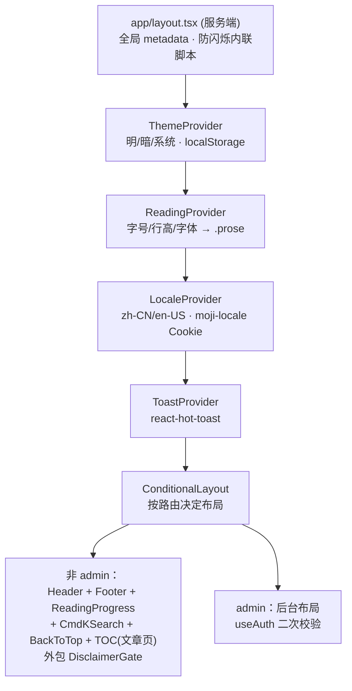

# 05 · 组件与 Hooks（src/components、src/hooks）

> 🏠 [Wiki 首页](README.md) ｜ ⬅️ [04-API 参考](04-api-reference.md) ｜ **当前：05 组件与 Hooks** ｜ 下一章 → [06-工具库与共享层](06-lib-shared.md)

**本文包含**：[1. 全局 Provider 体系](#1-全局-provider-体系) · [2. 布局组件](#2-布局组件) · [3. 动效组件](#3-动效组件motion) · [4. 功能组件](#4-功能组件) · [5. 自定义 Hooks](#5-自定义-hookssrchooks) · [6. 前台页面](#6-前台页面src-apppublic) · [7. 后台页面](#7-后台页面src-appadmin)

> 除特别说明外均为客户端组件（`"use client"`）；动画统一基于 framer-motion。

---

## 1. 全局 Provider 体系



## 2. 布局组件

| 文件 | 类型 | 职责 |
|---|---|---|
| [app/layout.tsx](file:///workspace/src/app/layout.tsx) | 服务端 | 根布局：全局 metadata、favicon/manifest、**主题与阅读偏好防闪烁内联脚本**、Provider 链（上图） |
| `components/layout/Header.tsx` | 客户端 | 顶部导航：logo、导航链接、语言/主题切换、Cmd+K 入口 |
| `components/layout/Footer.tsx` | 客户端 | 页脚：tagline、归档/搜索/订阅链接 |
| `components/layout/MobileSettingsSheet.tsx` | 客户端 | 移动端设置抽屉（主题/阅读/语言/专注模式） |
| [ConditionalLayout.tsx](file:///workspace/src/components/ConditionalLayout.tsx) | 客户端 | 非 admin 页渲染完整前台壳；文章页附加 `TableOfContents`；整体包 `DisclaimerGate` |

## 3. 动效组件（components/motion/）

| 组件 | 职责 |
|---|---|
| `PageTransition.tsx` | 路由切换过渡动画 |
| `ScrollReveal.tsx` | 进视口淡入/位移（`useInView`）；导出 `StaggerList`/`StaggerItem` 级联 |
| `PostReveal.tsx` | 文章内容揭示动画 |
| `ReadingProgress.tsx` | 顶部阅读进度条 |
| `BackToTop.tsx` | 返回顶部按钮 |
| `TableOfContents.tsx` | 从 `.prose` 提取 h1/h2/h3 生成目录；IntersectionObserver 高亮当前节；桌面侧栏 + 移动端导航 |
| `ImageZoom.tsx` | medium-zoom 图片点击放大，卸载时销毁 |
| `CmdKSearch.tsx` | Cmd/Ctrl+K 全局搜索弹层 → `/api/search` |
| `FocusMode.tsx` | 专注模式（隐藏干扰元素） |

## 4. 功能组件

### comment/
- `CommentSection.tsx` — 完整评论区：拉取 `/api/comments?postId=`；匿名评论**邮箱验证码流程**（verify-email → verify-code → 提交）+ 图形验证码；登录用户直提；提交后刷新列表

### disclaimer/
- `DisclaimerGate.tsx` — 检查 `disc_ok` Cookie → 未接受渲染 Modal → 同意后调 `/api/disclaimer/accept` 签发服务端 Cookie + 退出动画
- `DisclaimerModal.tsx` — 声明弹窗（多段文案 + 同意按钮 + 滚动锁定）

### editor/（后台编辑器核心）
- `TiptapEditor.tsx` — `@tiptap/react`：StarterKit + Underline/Link/Image/Highlight/**CodeBlockLowlight**(lowlight)/Placeholder/Typography；`getHTML()` 同步表单
- `ImageUploader.tsx` — 图集管理：拖拽/触摸排序、上传 `/api/upload`、关联 `/api/posts/{id}/images`、排序 `/api/posts/{id}/images/reorder`、预览

### post/
- `PostCard.tsx` — 文章卡片（标题/摘要/分类/标签/阅读时长/浏览与评论数）
- `ViewCounter.tsx` — 挂载时 POST `/api/view` 上报并展示浏览量（服务端 IP+slug 去重防刷）

### ui / i18n
- `Button.tsx` / `Input.tsx` — 基础原子组件（clsx 组合）
- `Translated.tsx` — 配合 LocaleProvider 的翻译渲染组件

## 5. 自定义 Hooks（src/hooks/，index.ts 统一导出）

| Hook | 职责 |
|---|---|
| `useAuth` | 当前用户状态（`/api/auth/me`）；admin 布局与编辑器鉴权依赖它 |
| `useDebounce` | 值防抖（搜索输入） |
| `useScrollLock` | 弹窗打开时锁定页面滚动 |
| `useEscapeKey` | Esc 关闭弹层 |

## 6. 前台页面（src/app/(public)/）

| 页面 | 关键实现 |
|---|---|
| 首页 `page.tsx` | `revalidate=300`；`generateMetadata`；服务端取最新 10 篇 |
| `about/page.tsx` | 关于页 |
| `archive/page.tsx` | 归档（按月分组，`postService.getArchive()`） |
| `post/[slug]/page.tsx` | `revalidate=300` + `generateStaticParams` + `generateMetadata`(OG)；正文 `sanitizeHtml(post.content)` 后渲染；含阅读时长/浏览量/分类标签/上一下一篇/评论区 |
| `category/[slug]/page.tsx` | 分类列表；`getPostsByCategory`；无结果 `notFound()` |
| `tag/[slug]/page.tsx` | 标签列表；`getPostsByTag` |
| `search/page.tsx` | 搜索页（客户端 + 防抖 → `/api/search`） |

辅助 Metadata Routes：`robots.ts`（禁 `/api/` `/admin/`）· `sitemap.ts`（动态含已发布文章）· `not-found.tsx`（水墨风 404）

## 7. 后台页面（src/app/admin/）

```mermaid
flowchart LR
    L["admin/layout.tsx<br/>Edge 已验签 → useAuth 二次校验<br/>未登录 → /admin/login"] --> DASH[dashboard 仪表盘<br/>/api/stats]
    L --> POSTS[posts 文章管理] --> ED[editor/[id]<br/>TiptapEditor + ImageUploader<br/>新 post / 改 put]
    L --> CAT[categories 分类树]
    L --> TAG[tags 标签]
    L --> CMT[comments 审核<br/>单条/批量]
    L --> FILES[files 文件管理<br/>/api/upload/list]
    L --> SET[settings 站点设置<br/>ConfigService]
```

| 页面 | 功能 |
|---|---|
| `layout.tsx` | 客户端鉴权壳：`useAuth()` 校验（Middleware Edge 层之外的二次校验） |
| `login/page.tsx` | 登录页（图形验证码 + CSRF） |
| `dashboard/page.tsx` | 仪表盘数据可视化 |
| `posts/page.tsx` | 文章管理（状态筛选/搜索/置顶/精华） |
| `editor/[id]/page.tsx` | 有 `postId` 走 PUT `/api/posts/{id}`，否则 POST `/api/posts`；支持草稿/发布 |
| `categories/page.tsx` | 分类树管理 |
| `tags/page.tsx` | 标签管理 |
| `comments/page.tsx` | 评论审核（通过/拒绝/删除，单条与批量） |
| `files/page.tsx` | 上传文件管理 |
| `settings/page.tsx` | 站点设置 |

> 💡 后台视觉规范集中在 [shared/admin-theme.ts](file:///workspace/src/shared/admin-theme.ts) 的 `adminTheme` 设计 token。

---

*⬅️ [上一章 04-API 参考](04-api-reference.md) ｜ 🏠 [Wiki 首页](README.md) ｜ ➡️ 下一章 [06-工具库与共享层](06-lib-shared.md)*
