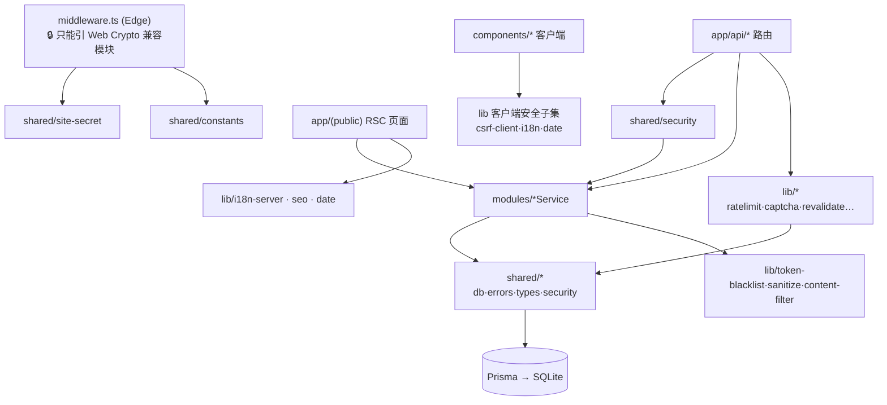

# 06 · 工具库与共享层（src/lib、src/shared）

> 🏠 [Wiki 首页](README.md) ｜ ⬅️ [05-组件与 Hooks](05-components.md) ｜ **当前：06 工具库与共享层** ｜ 下一章 → [07-依赖关系](07-dependencies.md)

**本文包含**：[一、shared/ 共享基础层](#一shared--共享基础层) · [二、lib/ 横切工具层](#二lib--横切工具层) · [三、依赖方向约定](#三依赖方向约定)

---

## 一、shared/ —— 共享基础层

### db.ts — 全项目唯一数据库入口

`export const prisma`：PrismaClient **全局单例**；非生产环境挂 `globalThis`，避免 dev 热重载重复建连接。

### errors.ts — 统一错误协议

| 导出 | 说明 |
|---|---|
| `class AppError` | `new AppError(message, statusCode=400, code?)` 业务错误基类 |
| `errorResponse(error)` | duck-typing 识别 AppError（避免跨 chunk instanceof 失效）、ZodError→400、P2003→409、其他 P 开头→500、Error→400、未知→500 |
| `successResponse(data, status=200)` | `{data}` 包装 |

### types.ts — Zod schema 单一事实源

页面/路由/服务三方共用：

| Schema | 要点 |
|---|---|
| `createPostSchema` | slug 仅小写字母数字连字符；status 枚举 draft/published/archived |
| `updatePostSchema` | `createPostSchema.partial()` |
| `createCommentSchema` | 昵称≤10 字符禁特殊字符；邮箱限 qq/gmail/163 |
| `loginSchema` / `registerSchema` | 密码≥6 位；用户名字符集白名单 |
| `updateProfileSchema` | **strict** 拒绝未知字段 |
| `updateCredentialsSchema` | `discriminatedUnion`（type: username/password） |
| `createTagSchema` / `createCategorySchema` | slug 正则约束 |
| `postImageUrlSchema` | 🔒 必须 `/uploads/` 前缀 |
| `reorderImagesSchema` | id 数组 |
| `paginationSchema` | page≥1、pageSize≤100 默认 12 |

另导出 `z.infer` 推断类型（`CreatePostInput` 等）与 `AuthUser` 接口。

### security.ts — 🔒 鉴权与密码核心

| 函数 | 说明 |
|---|---|
| `hashPassword` / `verifyPassword` | bcryptjs，12 轮 |
| `createToken({userId, role})` | jsonwebtoken 签发，**3 天**；生产缺 `JWT_SECRET` 启动抛错 |
| `verifyToken(token)` | 验签，失败抛 `AppError(401)` |
| `setAuthCookie` / `clearAuthCookie` / `getTokenFromCookie` | httpOnly Cookie `moji_token`，3 天，sameSite lax |
| `getCurrentUser()` | 读 Cookie → 黑名单检查 → 验签 → Prisma 查用户（select 白名单） |
| `requireAuth()` / `requireAdmin()` | 未登录 401 / 非 admin 403 |
| `hashIP(ip)` | `sha256(ip + IP_HASH_SALT)` 前 16 位 |
| `blacklistToken` | re-export |

### constants.ts — 集中常量

| 常量 | 值 |
|---|---|
| `SITE_HOST` / `ALLOWED_SITE_HOSTS` | `www.inklog.cn`（含非 www）⚠️ 换域名需改 |
| `ALLOWED_EMAIL_DOMAINS` | qq / gmail / 163 |
| `TOKEN_NAME` / `CSRF_COOKIE` / `CSRF_HEADER` | `moji_token` / `moji_csrf` / `x-csrf-token` |
| `DISCLAIMER_CLIENT_COOKIE` | `disc_ok`（仅 UI 提示，真鉴权靠 httpOnly） |
| `PROTECTED_IMAGE_HTML` | 防盗链 403 页完整 HTML |

### site-secret.ts — Edge 兼容的签名 Cookie

| 导出 | 说明 |
|---|---|
| `SITE_SECRET` | 启动读取，缺失抛错 |
| `SITE_VERIFY_COOKIE="site_v"` / `DISCLAIMER_COOKIE="moji_disc"` | Cookie 名 |
| `hmacSha256(msg, secret)` | Web Crypto 实现（**Edge 兼容**） |
| `timingSafeEqual(a, b)` | 恒定时间比较 |
| `createSiteVerifyToken / verifySiteToken` | 站点访问验证 Cookie（24h） |
| `createDisclaimerToken / verifyDisclaimerToken` | 免责声明同意 Cookie |
| `ALLOWED_CRAWLERS / isAllowedCrawler(ua)` | 搜索引擎与微信爬虫 UA 白名单 |

### files.ts — 上传文件清理

`extractUploadUrls(html)` 正则提取 `/uploads/` 图片 → `deleteUploadFile(url)` 路径安全校验（限定 uploads 目录内，防路径穿越）后 unlink → `cleanupPostImages(post)` 删文章时清理图集/封面/正文内嵌图。

### paginate.ts — 通用分页

`buildPaginationParams(page, pageSize)` → `{skip, take}`；`paginateResult(results, pageSize)` 取 `pageSize+1` 判断 `hasMore` 并截断（前台用；后台列表用 count 精确分页）。

### prisma-helpers.ts

`handlePrismaUniqueError(error, message)`：P2002 → `AppError`，Category/Tag Service 使用。

### cleanup-registry.ts — 定时清理注册表

`registerCleanup(name, fn, intervalMs)` / `unregisterCleanup` / `cleanupAll` / `getRegisteredTasks`。限流、浏览量去重、Token 黑名单清理均经它调度 → 防内存泄漏。

### admin-theme.ts

`adminTheme`：后台 UI 设计 token 集中定义。

## 二、lib/ —— 横切工具层

### 安全类

| 文件 | 导出 | 机制 |
|---|---|---|
| [captcha.ts](file:///workspace/src/lib/captcha.ts) | `createCaptcha()` / `verifyCaptcha(token, answer)` | 5 位随机码（剔除 0/O、1/l/I）+ 手绘 SVG（贝塞尔干扰线/噪点网格/干扰带）；存表带过期，**一次性消费** |
| [account-lockout.ts](file:///workspace/src/lib/account-lockout.ts) | `checkAccountLockout` / `recordLoginFailure` / `clearLoginFailures` | 内存记录：连续 5 次失败锁 30min（配合路由层 IP 级限流） |
| [token-blacklist.ts](file:///workspace/src/lib/token-blacklist.ts) | `blacklistToken` / `blacklistAllUserTokens` / `isTokenBlacklisted` / `cleanupExpiredTokens` | 存表（仅 sha256 哈希）；登录按 userId 全拉黑 = 🔒 **单地登录** |
| [csrf.ts](file:///workspace/src/lib/csrf.ts) | `setCsrfCookie` / `getCsrfTokenFromCookie` / `clearCsrfCookie` | 服务端签发/读取 `moji_csrf`（登录时设置） |
| [csrf-client.ts](file:///workspace/src/lib/csrf-client.ts) | `ensureCsrfToken()` / `getCsrfHeaders()` | 客户端生成 `{x-csrf-token, x-requested-with}`，**所有写请求必带** |
| [ratelimit.ts](file:///workspace/src/lib/ratelimit.ts) | `rateLimit` / `rateLimitPresets` / `getClientIP` | 内存 Map 固定窗口；IP 解析优先 `x-real-ip`（Nginx 不可伪造）兜底 XFF 左侧；预设 login 5/15min · register 3/h · comment 5/min · general 30/min |
| [content-filter.ts](file:///workspace/src/lib/content-filter.ts) | `checkSensitiveContent` / `checkRestrictedContent` / `checkContent` | 敏感词 + LINK/PHONE 正则 + 社交账号模式（微信/QQ/微博/抖音/小红书/TG/Discord）；评论发布前过滤 |
| [sanitize.ts](file:///workspace/src/lib/sanitize.ts) | `sanitizeHtml(html)` / `validateAndSanitizeComment(raw)` / `sanitizeText(text)` | DOMPurify + jsdom：文章白名单净化（页面无 CSP 时的 XSS 兜底）、评论严格净化、纯文本转义 |
| [sanitize-svg.ts](file:///workspace/src/lib/sanitize-svg.ts) | `sanitizeSvg(svgContent)` | SVG 专用净化（防 script/on* 注入），上传 SVG 时调用 |
| [email-session.ts](file:///workspace/src/lib/email-session.ts) | `setEmailVerifiedCookie` / `getVerifiedEmail` / `clearEmailVerifiedCookie` / `verifyCookieValue` | 匿名评论者邮箱"已验证"HMAC Cookie，一次验证后续免验 |

### 业务支撑类

| 文件 | 导出 | 说明 |
|---|---|---|
| [mailer.ts](file:///workspace/src/lib/mailer.ts) | `sendVerificationEmail(opts)` | nodemailer SMTP 验证码邮件（配置 `SMTP_*`） |
| [admin-email-codes.ts](file:///workspace/src/lib/admin-email-codes.ts) | `adminEmailCodes`（globalThis 单例） | 管理员敏感操作（绑邮箱/改密/改用户名）6 位码内存存储 |
| [revalidate.ts](file:///workspace/src/lib/revalidate.ts) | `revalidatePostPages(slug?, oldSlug?)` | 文章写操作后刷新首页/归档/文章页（新旧 slug）/分类/标签页缓存 |
| [seo.ts](file:///workspace/src/lib/seo.ts) | `buildMetadata({...})` | 统一 metadata（title/description/OG），基于 `NEXT_PUBLIC_SITE_URL` |

### 国际化与日期

| 文件 | 导出 | 说明 |
|---|---|---|
| [i18n.ts](file:///workspace/src/lib/i18n.ts) | `Locale` · `Translations`（强类型词典）· `getTranslations` · `t(key, locale)` · `getLocaleFromCookie` · `getLocaleFromAcceptLanguage` · `detectLocale` | 客户端/通用 i18n；解析顺序 Cookie → Accept-Language → zh-CN |
| [i18n-server.ts](file:///workspace/src/lib/i18n-server.ts) | `getServerLocale()` / `getServerTranslations()` | 服务端组件读取 middleware 注入的 `x-moji-locale` |
| [date.ts](file:///workspace/src/lib/date.ts) | `formatDate` / `formatDateTime` / `formatRelative` / `formatDateForArchive` | date-fns 按 locale 格式化 |

## 三、依赖方向约定

> 🔒 **关键约束**：middleware.ts 运行在 Edge Runtime，只能使用 Web Crypto（site-secret.ts）与常量，**不能引入 Prisma / Node crypto** —— JWT 验签因此在 middleware 内独立实现（`verifyTokenEdge`），见 [01-架构 §5.1](01-architecture.md#51-认证与会话)。

---

*⬅️ [上一章 05-组件与 Hooks](05-components.md) ｜ 🏠 [Wiki 首页](README.md) ｜ ➡️ 下一章 [07-依赖关系](07-dependencies.md)*
