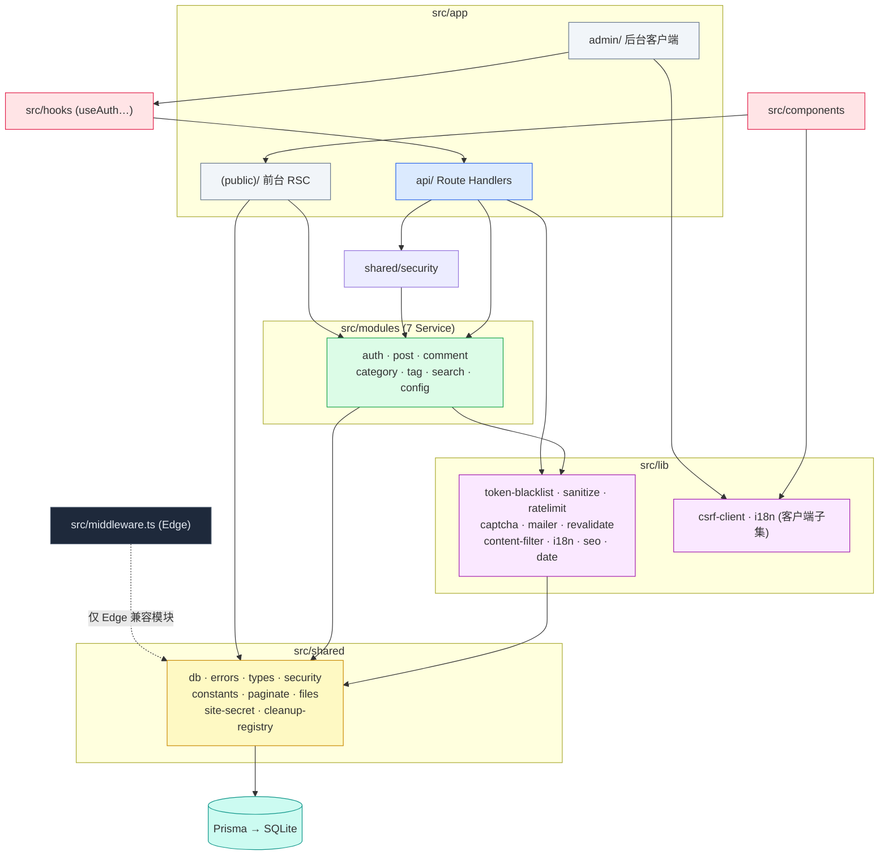

# 07 · 依赖关系

> 🏠 [Wiki 首页](README.md) ｜ ⬅️ [06-工具库与共享层](06-lib-shared.md) ｜ **当前：07 依赖关系** ｜ 下一章 → [08-运行与部署](08-running.md)

**本文包含**：[1. 运行时依赖](#1-运行时依赖dependencies) · [2. 开发依赖](#2-开发依赖devdependencies) · [3. 内部模块依赖图](#3-内部模块依赖图) · [4. 外部服务依赖](#4-外部服务依赖)

> 数据来源：[package.json](file:///workspace/package.json)（v1.1.68）

---

## 1. 运行时依赖（dependencies）

### 框架与运行基座

| 依赖 | 版本 | 用途 |
|---|---|---|
| `next` | ^15.3.0 | App Router、Route Handlers、Edge Middleware、ISR、rewrites |
| `react` / `react-dom` | ^19.1.0 | UI 运行时 |
| `@prisma/client` | ^6.7.0 | 类型安全数据库客户端（SQLite） |

### 认证与安全

| 依赖 | 用途 |
|---|---|
| `jsonwebtoken` | JWT 签发/验证（Node 侧；Edge 侧为自研 Web Crypto 实现） |
| `bcryptjs` | 密码哈希（12 轮） |
| `dompurify` + `jsdom` | HTML/XSS 白名单净化（服务端） |
| `zod` | 全部输入校验（shared/types.ts 单一事实源） |
| `cookie` | Cookie 解析 |

### 富文本与内容

| 依赖 | 用途 |
|---|---|
| `@tiptap/react` + `@tiptap/starter-kit` | 富文本编辑器内核 |
| `@tiptap/extension-{link,image,highlight,underline,placeholder,typography,code-block-lowlight}` | 编辑器扩展 |
| `lowlight` | 代码块语法高亮引擎 |
| `marked` | Markdown 渲染（辅助场景） |
| `medium-zoom` | 正文图片点击放大 |

### 媒体与邮件

| 依赖 | 用途 |
|---|---|
| `sharp` | 上传图片处理/压缩 |
| `nodemailer` | SMTP 邮件（邮箱验证码） |

### UI 与工具

| 依赖 | 用途 |
|---|---|
| `framer-motion` | 全站动效（滚动揭示、过渡、弹窗） |
| `lucide-react` | 图标库 |
| `react-hot-toast` | 全局 Toast |
| `lottie-react` | Lottie 动画（welcome.json） |
| `date-fns` | 日期格式化（i18n） |
| `clsx` | className 组合 |
| `nanoid` | 短随机 ID（文件名等） |

## 2. 开发依赖（devDependencies）

| 依赖 | 用途 |
|---|---|
| `typescript` ^5.8 | 严格模式类型检查（`ignoreBuildErrors: false`） |
| `prisma` ^6.7 | CLI：generate / db push / studio |
| `tailwindcss` ^4.1 + `@tailwindcss/postcss` | Tailwind 4 PostCSS 插件模式 |
| `tsx` | 直接运行 TS（seed 脚本） |
| `eslint` ^9 + `eslint-config-next` | Flat config（`next/core-web-vitals`）；⚠️ 构建时 lint 已忽略 |
| `@types/*` | node/react/jsonwebtoken/bcryptjs 等类型 |

## 3. 内部模块依赖图

**四条关键约束**：

1. 🔒 **Edge 边界**：middleware 只能引 Web Crypto 兼容模块（shared/site-secret.ts、shared/constants.ts），不得引 Prisma/Node API；JWT 验签由 `verifyTokenEdge` 独立实现
2. **类型单向流**：`shared/types.ts`（Zod）→ API 路由校验 → Service 接收推断类型 → 前端经 API 响应取数
3. **数据库单点**：所有 DB 访问经 `shared/db.ts` prisma 单例
4. **客户端不触库**：客户端组件只经 API 路由交互（写请求须带 CSRF 头）

## 4. 外部服务依赖

| 服务 | 用途 | 配置 |
|---|---|---|
| SMTP 邮箱（如 QQ 邮箱） | 邮箱验证码 | `SMTP_HOST/PORT/USER/PASS/FROM` |
| Nginx（生产推荐） | 反向代理 + TLS | 需转发 `x-real-ip`、`x-forwarded-proto/host` |
| SQLite 文件 | 数据存储 | `DATABASE_URL` |

---

*⬅️ [上一章 06-工具库与共享层](06-lib-shared.md) ｜ 🏠 [Wiki 首页](README.md) ｜ ➡️ 下一章 [08-运行与部署](08-running.md)*
