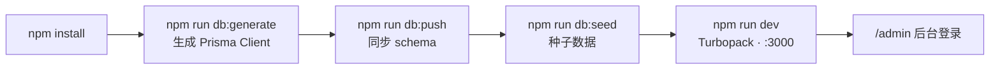

# 08 · 运行与部署

> 🏠 [Wiki 首页](README.md) ｜ ⬅️ [07-依赖关系](07-dependencies.md) ｜ **当前：08 运行与部署**（末章）

**本文包含**：[1. 环境要求](#1-环境要求) · [2. 环境变量](#2-环境变量) · [3. 开发运行](#3-开发运行) · [4. 生产构建](#4-生产构建与启动) · [5. PM2 部署](#5-pm2-部署推荐) · [6. Nginx 反代](#6-nginx-反向代理要点) · [7. 上线检查清单](#7-生产检查清单) · [8. 脚本速查](#8-项目脚本速查) · [9. 常见问题](#9-常见问题)

---

## 1. 环境要求

- Node.js ≥ 20（Next.js 15 要求）
- npm（或 pnpm/yarn）
- 无需外部数据库：默认 SQLite 文件数据库

## 2. 环境变量

复制 [.env.example](file:///workspace/.env.example) 为 `.env` 并修改：

| 变量 | 必填 | 说明 |
|---|---|---|
| `DATABASE_URL` | ✅ | SQLite 路径，默认 `file:./dev.db` |
| `JWT_SECRET` | ✅ 生产（缺失启动抛错） | JWT 签名密钥，随机长字符串 |
| `IP_HASH_SALT` | ✅ 生产（同上） | 评论 IP 哈希盐 |
| `SITE_SECRET` | ✅ | 站点验证/免责声明 Cookie 的 HMAC 密钥（随机 hex） |
| `NEXT_PUBLIC_SITE_URL` | ✅ | 站点对外地址（SEO/sitemap 用） |
| `SMTP_HOST/PORT/USER/PASS/FROM` | 邮件功能需要 | SMTP 配置（QQ 邮箱 smtp.qq.com:465，PASS 为授权码） |

> ⚠️ `shared/constants.ts` 中站点域名硬编码为 `www.inklog.cn`（Referer 白名单、403 页），换域名部署需同步修改 `SITE_HOST` / `ALLOWED_SITE_HOSTS`。

## 3. 开发运行



```bash
npm install                 # 安装依赖

npm run db:generate         # 生成 Prisma Client
npm run db:push             # 同步 schema 到 SQLite（首次/改模型后）
npm run db:seed             # 种子数据（管理员/分类/标签/示例文章）

npm run dev                 # 开发服务器 http://localhost:3000
```

其他：`npm run db:studio` Prisma 可视化管理

| 入口 | 地址 |
|---|---|
| 前台 | `http://localhost:3000` |
| 后台 | `http://localhost:3000/admin`（未登录跳 `/admin/login`） |
| 种子管理员 | 用户名 `饕餮_adminheibao`（admin，见 `prisma/seed.ts`） |

> ⚠️ seed 含默认密码明文，生产部署后立即修改。

## 4. 生产构建与启动

```bash
npm run build               # 严格 TS 类型检查（ignoreBuildErrors: false）；ESLint 构建时忽略
npm start                   # next start -H 127.0.0.1（仅监听本机，前置 Nginx）
```

## 5. PM2 部署（推荐）

[ecosystem.config.js](file:///workspace/ecosystem.config.js) 已内置：

```bash
pm2 start ecosystem.config.js
pm2 save
```

| 配置 | 值 | 说明 |
|---|---|---|
| `cwd` | `/home/blog/moji-blog` | ⚠️ 按实际路径修改 |
| `max_memory_restart` | 300M | 内存保护 |
| `listen_timeout` / `kill_timeout` | 10s / 5s | 零停机滚动重启 |
| `exp_backoff_restart_delay` | 200ms | 指数退避重启 |
| 日志 | merge + 时间戳 | 排障 |

## 6. Nginx 反向代理要点

应用监听 `127.0.0.1:3000`，以下请求头**代码强依赖**（缺失会导致限流/IP 哈希/防盗链异常）：

```nginx
proxy_set_header Host $host;
proxy_set_header X-Real-IP $remote_addr;          # 限流/IP 哈希依赖，不可伪造
proxy_set_header X-Forwarded-For $proxy_add_x_forwarded_for;
proxy_set_header X-Forwarded-Proto $scheme;        # middleware 还原真实 origin
proxy_set_header X-Forwarded-Host $host;

client_max_body_size 10m;                          # 上传限制
```

## 7. 生产检查清单

- [ ] 三个密钥（`JWT_SECRET` / `IP_HASH_SALT` / `SITE_SECRET`）均为随机值
- [ ] 已修改 seed 管理员默认密码
- [ ] `shared/constants.ts` 站点域名与实际域名一致
- [ ] `NEXT_PUBLIC_SITE_URL` 正确（影响 SEO/sitemap/OG）
- [ ] SMTP 可用（评论邮箱验证与管理员敏感操作依赖邮件）
- [ ] `uploads/` 目录持久化（容器部署挂载卷）
- [ ] SQLite 定期备份；规模增长后可迁移 PostgreSQL（改 prisma provider）

## 8. 项目脚本速查

| 命令 | 说明 |
|---|---|
| `npm run dev` | 开发服务器（Turbopack 热更新） |
| `npm run build` / `npm start` | 生产构建 / 启动（127.0.0.1） |
| `npm run lint` | ESLint 检查 |
| `npm run db:generate` | 生成 Prisma Client |
| `npm run db:push` | schema 同步数据库 |
| `npm run db:seed` | 运行种子脚本 |
| `npm run db:studio` | 数据库可视化管理 |

## 9. 常见问题

| 现象 | 原因 |
|---|---|
| 启动报 "JWT_SECRET environment variable is required" | 生产模式未配置环境密钥（security.ts / site-secret.ts 强制校验） |
| 图片 403 "图片受保护" | Referer 非站点域名且非爬虫 UA；Nginx 未转发 Host 头 |
| API 返回 403 "非法请求" | CSRF 失败：写请求缺 `x-requested-with: XMLHttpRequest` 或 `x-csrf-token` 与 `moji_csrf` Cookie 不匹配 |
| 登录提示锁定 | IP 级 15min 5 次限流，或用户名连败 5 次锁 30min（内存态，重启进程可清） |
| 改了数据前台未更新 | ISR 缓存 300s；管理端写操作会触发 `revalidatePostPages`，直接改库不会 |
| 评论验证码邮件收不到 | 检查 SMTP 配置与授权码；评论邮箱限 qq/gmail/163 域名 |

---

*⬅️ [上一章 07-依赖关系](07-dependencies.md) ｜ 🏠 [返回 Wiki 首页](README.md) ｜ ✅ 全部阅读完成*
