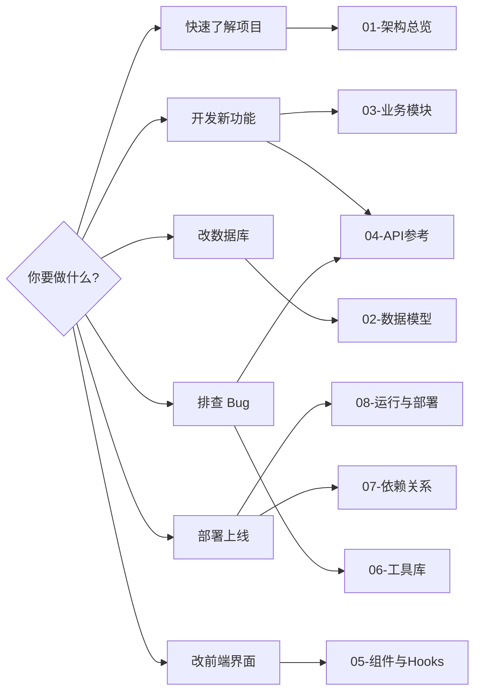
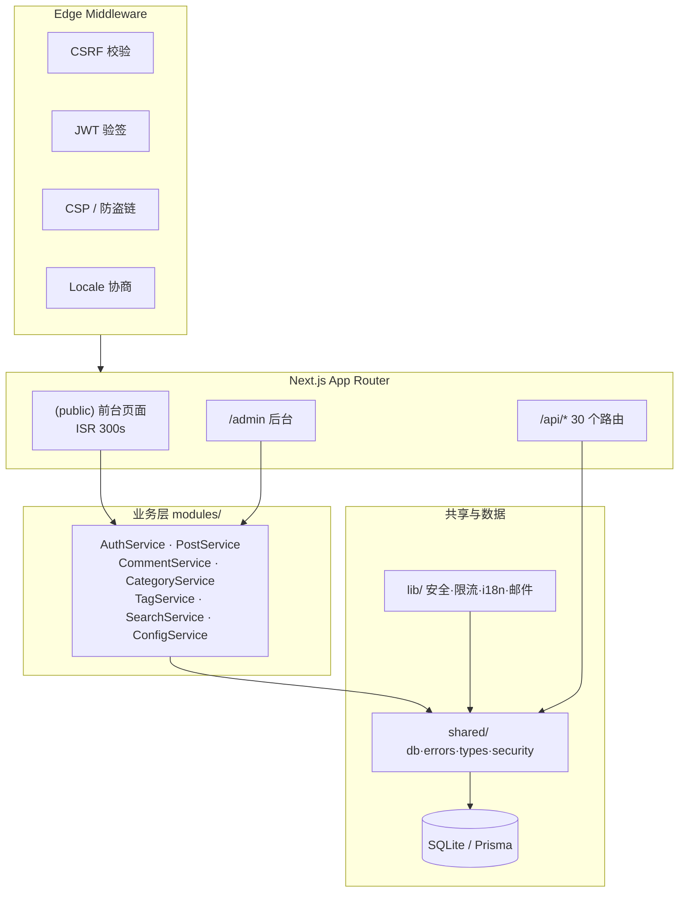

# 📖 Moji Blog · Code Wiki

> 基于 v1.1.68 源码逐文件分析生成的代码 Wiki，覆盖架构、模块、API、数据模型、依赖与运行全维度。

    

---

## 🗺️ 文档地图

| # | 文档 | 内容 | 适合谁读 |
|---|------|------|----------|
| 01 | [架构总览](01-architecture.md) | 分层架构 · 请求流转 · 渲染缓存 · 安全架构 · i18n | 所有人，**建议先读** |
| 02 | [数据模型](02-data-model.md) | 13 个 Prisma 模型 · ER 图 · 索引 · 级联策略 | 后端 / 全栈 |
| 03 | [业务模块](03-modules.md) | 7 个 Service 方法级说明 · 依赖关系 | 后端 / 全栈 |
| 04 | [API 参考](04-api-reference.md) | 30 个路由 · 44 个方法 · 鉴权与校验 | 前后端联调 |
| 05 | [组件与 Hooks](05-components.md) | 组件树 · Provider 体系 · 页面职责 | 前端 |
| 06 | [工具库与共享层](06-lib-shared.md) | `lib/` + `shared/` 全部导出与机制 | 后端 / 维护者 |
| 07 | [依赖关系](07-dependencies.md) | 技术选型 · 内部依赖图 · Edge 边界 | 架构评审 |
| 08 | [运行与部署](08-running.md) | 环境变量 · 命令 · PM2/Nginx · 排错 | 运维 / 新人上手 |

---

## 🧭 按场景阅读

---

## ⚡ 一分钟理解项目

**Moji Blog** 是一套水墨风格的单用户博客系统（站点 inklog.cn），核心特征：

- **前台**：`(public)` 路由组，全服务端组件 + ISR（300s）；文章正文为 Tiptap HTML，经 DOMPurify 白名单净化后渲染
- **后台**：`/admin`，Edge Middleware 层 JWT 验签 + 客户端 `useAuth` 双重校验；仪表盘 / 编辑器 / 评论审核 / 文件管理
- **API**：Route Handlers + Zod 白名单校验 + 统一错误响应；所有写操作经 Middleware 层 CSRF 双重校验
- **业务层**：`modules/` 按领域划分 7 个 Service 类，经 Prisma 单例访问 SQLite
- **安全横切**：限流、账号锁定、图形验证码、邮箱验证码、敏感词过滤、IP 哈希、上传魔数校验、防盗链

---

## 📌 文档约定

| 标记 | 含义 |
|---|---|
| 🔒 | 涉及安全机制，修改需谨慎 |
| ⚠️ | 注意事项 / 常见坑 |
| 💡 | 设计亮点或背景说明 |
| `file://` 链接 | 跳转到源码文件 |

- 代码路径均以 `src/` 为根；行号基于 v1.1.68
- 所有图表使用 Mermaid 绘制，支持 GitHub / VSCode / Trae 渲染

---

*[返回顶部](#-moji-blog--code-wiki) ｜ 从 [01-架构总览](01-architecture.md) 开始阅读 →*
